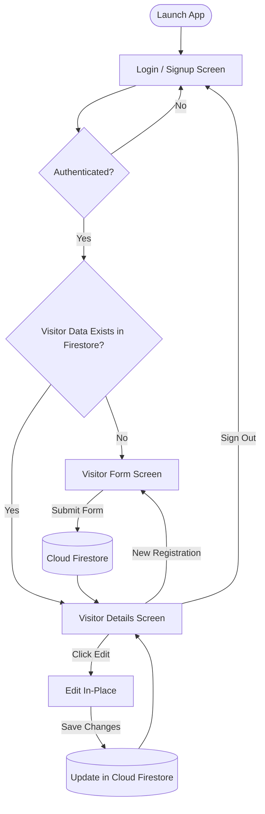

# 🏢 Visitor Registration System

A modern, responsive, and secure **Visitor Registration & Management System** built using **Flutter (Dart)** and powered by **Google Firebase** (Firebase Authentication & Cloud Firestore).

---

## 📌 Project Overview

The **Visitor Registration System** simplifies the process of checking in and managing visitors in an organization, campus, or office environment. Rather than relying on traditional paper logbooks, this application allows visitors or administrators to securely register, review, and update their visit details digitally.

The application features a modern **Material 3 UI** with gradient aesthetics, smooth animations, validation handling, and real-time synchronization with **Google Cloud Firestore**.

---

## ✨ Key Features

- 🔐 **User Authentication**: Secure Sign-in and Sign-up functionality using **Firebase Authentication** (Email & Password).
- 🧠 **Smart Post-Login Routing**:
  - If a user has **previously submitted details**, the app directly opens their **Visitor Details Page**.
  - If it is a **first-time user**, the app automatically routes them to the **Visitor Application Form**.
- 📋 **Visitor Application Form**:
  - Captures Full Name, Phone Number, Date of Birth (interactive date picker), Email, Address, and Purpose of Visit.
  - Includes real-time form validation and error handling.
- ✏️ **View & Edit Details**:
  - Displays a clean profile summary card with visitor details.
  - Built-in **Edit Mode** allowing users to update their information directly.
  - Instant live updates synced to Cloud Firestore.
  - Discard/Cancel option to revert uncommitted edits.
- ➕ **Multiple Submissions**: Option to create additional visitor registrations from the details screen.
- 🎨 **Modern Material 3 UI/UX**:
  - Vibrant gradient color palette with rounded card containers.
  - Password visibility toggle.
  - Loading indicators during asynchronous database transactions.
  - Floating toast notifications (Snackbars) with status icons.

---

## 🛠️ Technology Stack

| Component | Technology |
|---|---|
| **Framework** | [Flutter](https://flutter.dev/) (SDK ^3.14.0 or higher) |
| **Language** | [Dart](https://dart.dev/) |
| **Authentication** | [Firebase Authentication](https://firebase.google.com/products/auth) |
| **Database** | [Cloud Firestore](https://firebase.google.com/products/firestore) (NoSQL Document Store) |
| **Target Platform** | Web (Google Chrome) / Windows Desktop / Android |

---

## 📂 Project Structure

```text
visitor_registration_app/
├── lib/
│   ├── main.dart                   # Application entry point & Material 3 theme configuration
│   ├── login_screen.dart           # Authentication screen (Sign In / Sign Up) & route logic
│   ├── visitor_form_screen.dart    # Visitor registration form with date picker & validation
│   ├── visitor_details_screen.dart # View, edit, and real-time update visitor information
│   └── firebase_options.dart       # Firebase platform configuration credentials
├── web/                            # Web platform configuration & assets
├── windows/                        # Windows desktop runner & CMake files
├── android/                        # Android platform runner & Gradle files
├── pubspec.yaml                    # Project dependencies & environment configuration
└── README.md                       # Project documentation
```

---

## 🔄 How the Application Works



1. **Authentication**: Users can sign up with an email and password or sign in with existing credentials.
2. **Data Retrieval**: Upon login, the app checks the `visitors` collection in Cloud Firestore for records matching the authenticated user's `userId`.
3. **Registration / Details Flow**:
   - First-time visitors complete the registration form and submit their information.
   - Returning visitors see their saved information and can toggle the **Edit** button to update their profile in Firestore.

---

## 🚀 Step-by-Step Setup & Execution Guide for Evaluators / Faculty

Follow the instructions below to run this application from scratch on your local machine.

---

### Step 1: Prerequisites

Make sure the following tools are installed:
- **Git**: [Download Git](https://git-scm.com/downloads)
- **Google Chrome**: Recommended for running Flutter Web quickly without setting up heavy emulators.

---

### Step 2: Install Flutter SDK (If Not Already Installed)

If you already have Flutter installed, skip to **Step 3**.

#### For Windows:
1. Download the Flutter SDK bundle from the official site:
   👉 **[Download Flutter SDK for Windows](https://docs.flutter.dev/get-started/install/windows)**
2. Extract the downloaded `.zip` file into an appropriate folder (e.g., `C:\src\flutter`).
   > ⚠️ **Note**: Do not extract Flutter into `C:\Program Files\` as it requires elevated privileges.
3. Add Flutter to your System PATH:
   - Search for **"Edit the system environment variables"** in the Windows Start menu.
   - Click **Environment Variables**.
   - Under **User variables**, select `Path` and click **Edit**.
   - Click **New** and add the path to Flutter's `bin` directory (e.g., `C:\src\flutter\bin`).
   - Click **OK** to save and close all dialogs.
4. Open a **new** Command Prompt or PowerShell window and verify the installation:
   ```powershell
   flutter --version
   ```

#### For macOS / Linux:
Refer to the official installation guide:
- [macOS Setup](https://docs.flutter.dev/get-started/install/macos)
- [Linux Setup](https://docs.flutter.dev/get-started/install/linux)

---

### Step 3: Verify Flutter Environment

Run the Flutter health-check tool in your terminal:
```bash
flutter doctor
```
> ✅ **Important**: As long as **Flutter** and **Chrome** have green checkmarks (`[√]`), you are fully ready to run this application on Flutter Web. You do **not** need Android Studio or Visual Studio C++ if running on Chrome.

---

### Step 4: Clone the Repository

Clone the project to your local machine using Git:
```bash
git clone <YOUR_GIT_REPOSITORY_URL>
cd visitor_registration_app
```

---

### Step 5: Install Project Dependencies

Fetch all necessary packages and dependencies defined in `pubspec.yaml`:
```bash
flutter pub get
```

---

### Step 6: Run the Application

Launch the application directly in Google Chrome:

```bash
flutter run -d chrome
```

*(Optional: To run on Windows Desktop if Visual Studio with C++ is installed)*:
```bash
flutter run -d windows
```

The application will compile and open automatically in a Chrome browser window.

---

## 🧪 Testing the Application (Walkthrough for Evaluation)

1. **Create an Account**:
   - In the login card, enter any email (e.g., `testvisitor@example.com`) and a password (at least 6 characters).
   - Click **Create Account**.
2. **Fill Visitor Form**:
   - The form will open automatically. Fill in the details:
     - **Full Name**
     - **Phone Number**
     - **Date of Birth** (click to open the calendar picker)
     - **Email Address**
     - **Address**
     - **Purpose of Visit**
   - Click **Submit Registration**.
3. **View Details**:
   - You will be navigated to the **Visitor Details** screen displaying your submitted information.
4. **Test the Edit Feature**:
   - Click the **Edit** button in the top right of the details card.
   - Change any field (e.g., update the phone number or purpose of visit).
   - Click **Save Changes**. The updated information is saved to Firebase Cloud Firestore immediately.
5. **Test Returning Visitor Flow**:
   - Click the **Logout** icon at the top left to return to the sign-in screen.
   - Log back in with the same email and password.
   - Notice that the app **bypasses the form** and directly opens your **Visitor Details** page with your previously saved details intact.

---

## 🔒 Security & Firebase Notes

- Firebase configuration is set up via `firebase_options.dart` connecting to the project backend.
- Visitor entries in Firestore include the authenticated user's `userId`, ensuring records are associated with the respective account.
- In-memory sorting is implemented to guarantee smooth retrieval without requiring manual Firestore composite indexes.

---

## 👥 Author & Acknowledgements

- Developed as a database-driven visitor registration system demonstrating Flutter frontend architecture integrated with Google Firebase Cloud infrastructure.
